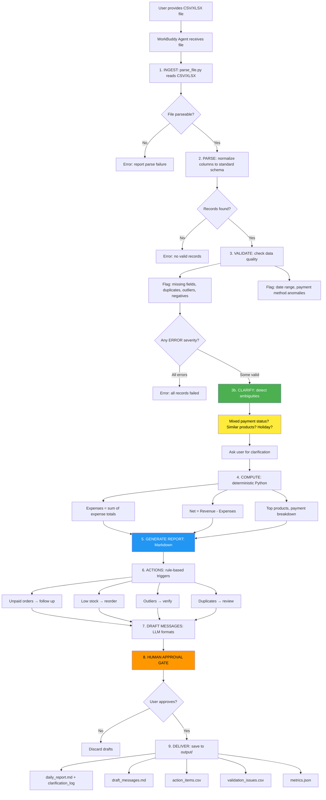
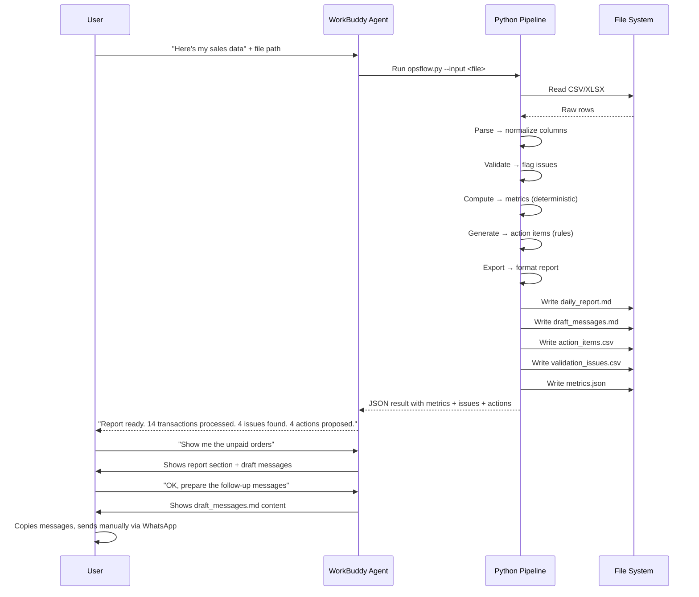

# UMKM OpsFlow — Workflow Diagram (Mermaid)



## Layer Separation

```mermaid
graph LR
    subgraph LLM Layer [LLM Layer - WorkBuddy Agent]
        L1[Understand user intent]
        L2[Format report text]
        L3[Draft follow-up messages]
        L4[Explain results]
    end
    
    subgraph Python Layer [Deterministic Layer - Python Scripts]
        P1[Parse input file]
        P2[Validate records]
        P3[Compute all metrics]
        P4[Generate action items]
        P5[Export to files]
    end
    
    subgraph File System [File System - Local Only]
        F1[Read: data/*.csv]
        F2[Write: output/*.md]
        F3[Write: output/*.csv]
        F4[Write: output/*.json]
    end
    
    LLM Layer -->|pre-computed data| Python Layer
    Python Layer -->|structured results| LLM Layer
    Python Layer -->|read/write| File System
    
    style LLM Layer fill:#e3f2fd
    style Python Layer fill:#e8f5e9
    style File System fill:#fff3e0
```

## Data Flow with Audit Trail


